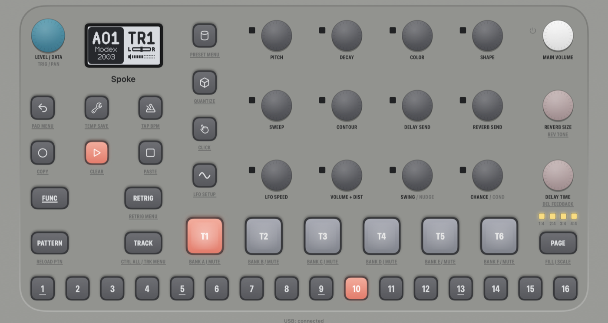

<div align="center">

# Vladiktron Spoke

**Elektron's Model:Cycles OS, running on a virtual board in a Mac app.**

Not a lookalike synth: the real OS 1.13 boots, draws the screen, runs the sequencer and makes the sound.

[](https://github.com/imaf6971/vladiktron-spoke/actions/workflows/ci.yml)
[](LICENSE)




</div>

## Features

- 🎛️ **The whole front panel:** screen, keys, knobs, pads and LEDs, all driven by the OS itself
- 🔊 **Audio** through Core Audio, to the output you pick in Settings
- 🎹 **MIDI** as two CoreMIDI port pairs, one for USB and one for the TRS jacks, as on the hardware
- 🔌 **USB audio both ways:** route it through a loopback device to record in a DAW or play into the Model:Cycles
- 🎚️ **Arturia MiniLab 3** support: in DAW mode it becomes the whole front panel, with pad colours following the LEDs
- 💾 **Your work stays:** quitting powers the OS off properly, so the active project is saved to the +Drive

> [!IMPORTANT]
> **Bring your own firmware.** The app includes no Elektron code. It installs the OS from the free update on
> [Elektron's support page](https://www.elektron.se/support-downloads/modelcycles#resources).

## Getting started

There is no download yet, so build it from source. You need an Apple Silicon Mac with macOS 14 or later, the Xcode
command line tools and CMake. Everything else is in this repository.

```bash
git clone https://github.com/imaf6971/vladiktron-spoke.git
```

```bash
cd vladiktron-spoke && ./build.sh
```

```bash
open "build/Vladiktron Spoke.app"
```

On first run, choose or drop `model-cycles_OS1.13.zip`, or the `.syx` inside it, on the window. Only Elektron's
original OS 1.13 is accepted. If you already have the `.syx`, `./build.sh model-cycles_OS1.13.syx` installs it during
the build.

## Playing it

| Control | Mouse | Keyboard |
|---|---|---|
| Keys and pads | Click and hold. ⌥-click latches a key for combinations such as PATTERN + step | Shift = FUNC, Space = PLAY |
| Knobs | Drag up or down, or scroll over them. One step is one detent | |
| LEVEL/DATA | Click without dragging to press it (open, confirm) | Return |

### MIDI

Two port pairs appear on your Mac:

- **Model:Cycles** is the USB-MIDI port.
- **Model:Cycles TRS** is the MIDI IN and OUT/THRU jacks.

Notes on channels 1–6 play tracks 1–6, and the auto channel (10) plays the active track. What the Model:Cycles sends
is set in its own MIDI config menu, as on the hardware. Out of the box it sends nothing.

### USB audio

Pick the routes in the **USB Audio** menu or in Settings. *Model:Cycles to* chooses the Mac output for its main mix
(48 kHz, stereo). *Into Model:Cycles from* chooses the input that feeds it, which is mixed into its output at −18 dB;
macOS asks for microphone access. To use it from a DAW, route through a loopback device such as BlackHole.

### Arturia MiniLab 3

It is picked up automatically when connected. Press **Shift + Prog** for DAW mode, which gives you the full mapping
with names on the MiniLab's display.

<details>
<summary><b>DAW mode mapping</b></summary>

| MiniLab 3 | Model:Cycles |
|---|---|
| Shift | FUNC, held while Shift is held |
| Main encoder, its press | LEVEL/DATA, LEVEL/DATA press |
| Shift + main encoder press | Keys: PANEL (the default) ⇄ NOTES (keys play the active track, strips bend and modulate) |
| Knobs 1–8 (endless) | PITCH, DECAY, COLOR, SHAPE, SWEEP, CONTOUR, DELAY SEND, REVERB SEND |
| Faders 1–4 | LFO SPEED, VOLUME + DIST, SWING, CHANCE: the fader position is the value (MIDI CC 102, 7, 15, 14 on the auto channel) |
| Pads A1–A6, A7, A8 | The six pads (velocity), PLAY, STOP |
| Pads B1–B8 (optional) | RECORD, PATTERN, TRACK, PAGE, RETRIG, LFO, BACK, MACHINES |
| PANEL keys (octave 0) | F3–G#4 = trigs 1–16; C3–E3 = FUNC, RECORD, PATTERN, TRACK, PAGE; A4–C5 = RETRIG, PUNCH, GATE, BACK |
| PANEL strips (tap a half) | Pitch strip: TEMPO above, SETTINGS below. Mod strip: MACHINES above, LFO below |

Shift + a key gives its FUNC function, as printed under the Model:Cycles keys: Shift + BACK opens the pad configuration
menu, Shift + PUNCH the QUANTIZE menu, and so on. Shift + pads 1–3 stay the MiniLab's own (pad bank, program), so
FUNC + those pads goes through the FUNC key of the PANEL layer.

Each value a knob moves is one value step on the Model:Cycles. Turned fast, it speeds up as with its own knobs.

</details>

<details>
<summary><b>Arturia mode mapping</b></summary>

With factory settings the MiniLab plays the Model:Cycles with a smaller mapping:

| MiniLab 3 | Model:Cycles |
|---|---|
| Keys and strips | Play the active track |
| Pads A1–A6, A7, A8 | The six pads, PLAY, STOP |
| Pads B1–B6, B7, B8 | Select track 1–6, RECORD, TEMPO |
| Knobs 1–8 (absolute: they stop at 0 and 127) | As in DAW mode |
| Faders 1–4 | As in DAW mode |

Other MiniLab programs or controllers need their CC numbers in `app/MiniLab.swift`.

</details>

## Your data

Everything lives in `~/Library/Application Support/Vladiktron Spoke/`. **Model:Cycles → Reveal Data Folder** opens it.

- **Quitting** takes about two seconds: the OS shows "Shutting down...", saves the active project and powers off.
- **Reset +Drive…** starts with an empty +Drive and keeps your settings.
- **Factory reset…** does the same and also restores the factory settings.
- **Install OS…** installs the firmware again, for example to bring back a missing file.

## Known limitations

- **The FACTORY presets are empty.** The OS fills them from data written to the +Drive at Elektron's factory, which
  is in no OS update. Your own presets save and load normally.
- **Other apps don't see an audio device.** USB audio goes through a device you choose, not a "Model:Cycles" audio
  device, so a DAW needs a loopback device.
- **Apple Silicon only, and not notarised.** Build it yourself for now.
- **Tested on macOS 27 only.** It is built for macOS 14 and later, but hasn't been run on anything older.
- **Some hardware isn't modelled:** battery level, auto-off and headphone detect.

[docs/RELEASE.md](docs/RELEASE.md) lists everything left before a release.

## How it works

The Model:Cycles has a ColdFire CPU. `src/mcboard.c` is a virtual board around it: interrupt controllers, timers, DMA,
flash, eMMC, the front-panel bus, MIDI, USB and the audio path. A patched
[Unicorn](https://github.com/unicorn-engine/unicorn) runs the OS's code on that board, and a SwiftUI app connects the
board to your Mac's screen, audio and MIDI.

| Folder | What's in it |
|---|---|
| [`app/`](app) | The SwiftUI app |
| [`src/`](src) | The virtual board and the firmware decoder |
| [`tools/`](tools) | Command-line tools and scripts |
| [`tests/`](tests) | C and Swift tests |
| [`vendor/`](vendor) | Unicorn 2.1.4 with this project's changes |
| [`docs/`](docs) | Development notes |

To run the tests after building:

```bash
./test.sh
```

[docs/DEVELOPMENT.md](docs/DEVELOPMENT.md) covers the build, every test and tool, and the debug logs.

## Licence

GPL-2.0-only, see [LICENSE](LICENSE). Third-party code and its licences are listed in
[THIRD-PARTY-NOTICES.md](THIRD-PARTY-NOTICES.md). This project builds on
[Modded-Cycles](https://github.com/18nelli18/Modded-Cycles) and [Unicorn](https://www.unicorn-engine.org/).

Model:Cycles and Elektron are trademarks of Elektron Music Machines MAV AB. This project is not affiliated with or
endorsed by Elektron.
